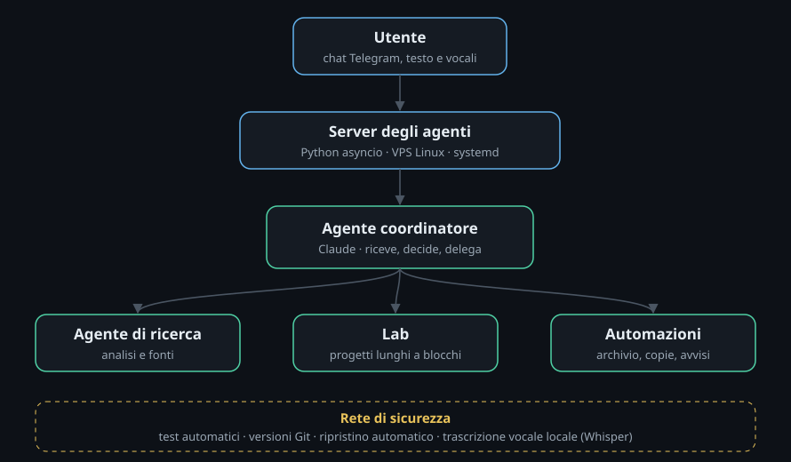

# Agentic AI System

A team of AI agents running 24/7 on a dedicated Linux server and reachable from a phone. A **coordinator agent** receives requests, delegates work to **specialised agents**, manages its own codebase and ships updates safely, with automated tests and automatic rollback.

> **About this repository.** This is a public showcase: architecture, design choices and a few selected source files. The full source code is kept private and can be walked through in an interview. Code comments are in Italian, my working language for this project.

## What it does
- **Coordinator and specialised agents.** Requests arrive through Telegram (text or voice). The coordinator answers directly or hands tasks to specialised agents (for example research and analysis) and reviews their output before reporting back.
- **Long-running projects.** Large builds run in the background in time-boxed blocks, each a fresh agent session that picks up from a shared plan. The scheduler reads the AI plan's usage and pauses automatically before limits are hit, then resumes on its own.
- **Self-maintaining.** The coordinator changes its own code on request: tests run, a new version is committed, the service restarts. If the new version fails to start, a safety net parks it on a separate branch, restores the last known-good version and notifies the user.
- **Local speech-to-text.** Voice messages are transcribed on the server with Whisper, without external services.
- **Scheduled automations.** Knowledge-base tidy-up, backups and alerts (errors, disk space, usage).

## Tech stack
Linux VPS (Hostinger) · Ubuntu · Python (asyncio) · Claude (Anthropic) via Claude Code · Telegram Bot API · systemd (user services, timers) · Git (versioning and rollback) · SQLite · faster-whisper

## Selected code
| File | What it shows |
|---|---|
| [`excerpts/aggiorna.sh`](excerpts/aggiorna.sh) | Safe deploy: tests, versioned commit, restart |
| [`excerpts/ripristina.sh`](excerpts/ripristina.sh) | Automatic rollback to the last known-good version |
| [`excerpts/versions.py`](excerpts/versions.py) | Promotion of a healthy version to "known-good" |
| [`excerpts/agent_jobs.py`](excerpts/agent_jobs.py) | Task delegation from the coordinator to specialised agents |
| [`excerpts/lab.py`](excerpts/lab.py) | Long-running work in blocks with usage-aware pausing |

---
William Cuccovillo · [LinkedIn](https://www.linkedin.com/in/william-cuccovillo-7078aab1/)
